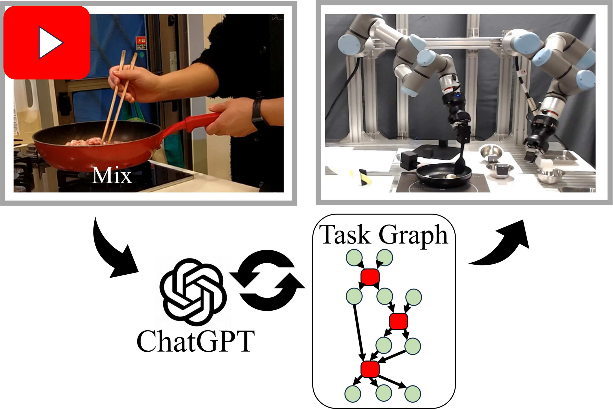

# [CASE2025] Cooking Task Planning using LLM and Verified by Graph Network

[](https://arxiv.org/abs/2503.21564)

<p align="center">
    
</p>

This repository contains the official implementation of the "Cooking Task Planning using LLM and Verified by Graph Network" by Ryunosuke Takebayashi, Vitor Hideyo Isume, Takuya Kiyokawa, Weiwei Wan, Kensuke Harada and presented at CASE2025.

## 📋 TODO 

- [X] Initial code upload. 
- [X] Adding instructions for execution. (Except Motion Planning)
- [ ] Adding instructions for motion planning
- [ ] Adding requirements.txt / conda environment instructions
- [ ] Docker environment?

## Installation

## Video Analysis

## Graph Generation

## Usage
1. Split frames of video and segment actions based on subtitles.
Note: modify paths on the script and setup credential for google vision

```
cd ./cooking_task_planning
python scripts/Video_Analysis_gvision.py
```
2. Estimate the target object node using ChatGPT.
Notes:  -make sure the "input_folder" path is the same as the "save_path_folder" from "Video_Analysis_gvision.py"
        -specify the video title (Vtitle)
        -set the OpenAI API key in the __init__ function of GPT_manipulation class in "GPT_manipulation.py"
```
python scripts/MainFunctionUnit_Generator.py
```
3. Create an environment object node.
Note: make sure the path matches the 'G_list.pickle' file generated by "MainFunctionUnit_Generator.py".
```
python scripts/EnvObjectNode.py
```
4. Create FOON
Note: make sure the paths for "G_list.pickle" is correct.
```
python scripts/TaskPlanner.py
```
5. Use the motion_planning/Motion_planner.py (Incomplete)
Note: Motion planner uses the WRS system.
```
python motion_planning/Motion_planner.py
```


## Citation
If you find our work helpful, please consider citing:
```bibtex
@article{takebayashi2025cooking,
  title={Cooking Task Planning using LLM and Verified by Graph Network},
  author={Takebayashi, Ryunosuke and Isume, Vitor Hideyo and Kiyokawa, Takuya and Wan, Weiwei and Harada, Kensuke},
  journal={arXiv preprint arXiv:2503.21564},
  year={2025}
}
```
